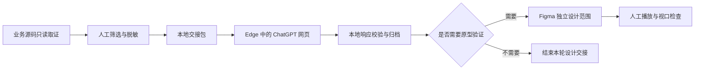

# CURRENT_WORKFLOW_AUDIT.md

## 审计结论与证据口径

当前工作流由本地源码只读取证、人工整理交接材料、Edge 中的 ChatGPT 网页会话、本地响应校验与归档，以及可选的 Figma 原型操作组成。各阶段跨越多个应用，交接和复核仍由操作者控制；本报告不把它描述为无人值守的端到端自动化。

证据标签按下列含义使用：

- **VERIFIED**：由当前项目源码、配置或可重复的本地检查直接确认。
- **OBSERVED**：在实际工作流中观察到，但不等于自动化验收。
- **INFERRED**：根据已检查的源码和观察结果推断。
- **NOT VERIFIED**：本次审计没有取得直接验证证据。

本报告保留工作流和产品范围事实，不公开业务仓库别名、私有源码文件清单、机器路径、会话记录、私有材料指纹或具体授权轨迹。

## 1. 参与方与数据边界

### 本地源码只读检查

操作者使用本地命令读取客服客户端业务仓库中与当前设计任务相关的源码和文档。项目内没有独立服务自动扫描该业务仓库；读取范围由操作者选择，并在进入交接材料前进行人工筛选与脱敏。

业务源码在该流程中属于只读输入。工作流工具和生成的交接材料保留在本项目；审计不要求在业务仓库中安装依赖、生成文件、运行测试或写入产物。

### 本地交接工具

C2C handoff 工具处理项目内提供的相对路径输入，并验证交接包的结构与本地状态。源码检查发生在工具之外；该工具不会自行扫描客服客户端业务仓库，也不会替操作者决定哪些源事实应发送给模型。

本地运行记录和个人会话材料不属于公开交接包。发布的研究材料应只包含已审查、被报告引用且适合公开的证据副本。

### 外部网页与设计工具

ChatGPT 通过 Edge 网页界面使用；本审计未发现项目内的 GPT API 发送适配器。发送前由操作者审查交接内容，响应通过网页界面取回后再进入本地校验流程。

Figma 操作属于单独的设计阶段。是否执行写入由具体任务授权和本地安全边界决定；原型证据与正式产品代码分开管理。本报告不记录真实文件身份、页面节点标识、会话链接或个人操作轨迹。

## 2. 工作流

1. 从客服客户端产品的相关源码和既有设计材料中选取当前任务所需事实，保持源仓库只读。
2. 人工整理脱敏后的设计请求，并将其放入本项目的本地交接流程。
3. 使用 ChatGPT 网页界面完成请求与响应交接；不把浏览器会话包装成自动 API 集成。
4. 在本地检查响应格式、范围和引用，再决定是否纳入后续设计工作。
5. 如任务明确需要 Figma 原型操作，则在单独的测试设计范围内执行，并由操作者检查结果。
6. 对原型进行人工播放和主要视口检查；该步骤不等价于正式产品的浏览器兼容性或端到端验收。

交接流程如下：

## 3. 交接、校验与状态

本地 handoff 实现负责处理项目内输入和交接状态，不负责访问或修改业务源码仓库。输入应使用受控的相对路径；输出应经过结构校验后再交给后续步骤。

浏览器会话、响应采集和本地归档之间仍存在人工交接，因此需要区分“本地包校验通过”与“真实网页端完整集成通过”。若自动化运行遇到外部状态不确定，应停止并由操作者核对，不应自动重放可能有副作用的动作。

## 4. H5 产品与原型范围

研究范围围绕客服客户端 H5 的移动端交互，包含“我的反馈”相关的列表、状态筛选、内容展示和空态等设计事实。视觉检查以移动端布局为主，并关注窄屏适配；原型用来讨论结构和交互，不代表正式产品实现或生产验收。

设计材料中的具体页面文件、Figma 文件身份、节点映射、私有源码路径和历史授权记录均不作为公开证据。公开描述保留用户可理解的产品行为和视觉约束，不暴露私有仓库内部结构。

## 5. 组件关系与职责

- **本地命令与操作者**：读取获准的源码材料、筛选事实并控制交接节奏。
- **C2C handoff**：校验本地交接输入和状态；不承担源码扫描或网页自动化职责。
- **Edge / ChatGPT 网页**：接收经审查的请求并返回设计建议；本审计不宣称它已通过项目内 API 集成。
- **本地归档与校验**：检查取回内容的格式和任务范围，保留经筛选的研究证据。
- **Figma 与原型播放**：在单独的设计范围内展示和检查交互，不直接修改正式业务代码。

各组件通过本地文件和人工确认衔接。浏览器会话和设计文件不是本项目的共享状态源；本地 handoff 状态也不应被解释为远程服务已完成业务动作。

## 6. 当前观察与瓶颈

**OBSERVED**：主要等待和返工发生在应用间切换、网页请求往返、响应复制、设计材料导入以及人工播放检查。流程需要清晰的输入/输出边界和可恢复的本地状态。

**INFERRED**：减少不必要的往返、统一交接包校验和明确失败后的人工核对步骤，能降低操作遗漏。此判断没有用公开运行日志或基准测试量化。

## 7. 验证状态与限制

- **VERIFIED**：项目内 handoff 工具的输入由项目本地相对路径提供；工具实现不扫描客服客户端业务仓库。
- **OBSERVED**：网页请求、响应取回和原型检查包含操作者控制的步骤。
- **NOT VERIFIED**：本次工作流审计没有运行完整自动化端到端测试、正式产品浏览器验收或生产集成检查。
- **NOT VERIFIED**：网页端 ChatGPT 与 Figma 之间不存在由本项目自动保证的事务性或自动重试语义。

本报告针对流程边界，不替代各组件自己的测试报告。单元测试、合成后端测试、真实上游 CLI 集成、浏览器运行验收和正式产品验收必须分别记录，不得互相替代。

## 8. 只读审计边界

本审计以检查流程和源码为目的，不通过该报告授权访问或修改业务仓库、外部服务或设计文件。任何外部写入都必须由具体任务授权，并由操作者在相应目标和范围内复核。

公开副本省略精确机器路径、会话标识、文件身份、私有源码摘要、材料指纹和用户授权历史。未随公开包发布的本地运行记录不作为可公开复现证据。