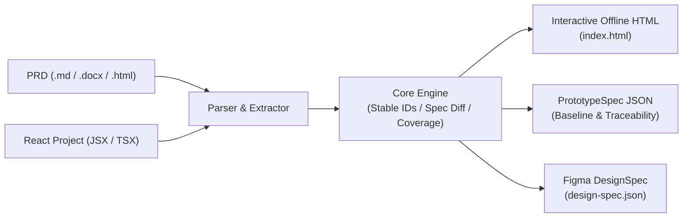

# protype-code

[](https://github.com/threeMoreTime/protype-code/actions/workflows/prototype.yml)
[](https://nodejs.org/)
[](LICENSE)

> **English Overview**: `protype-code` is a deterministic prototyping engine that turns PRD documents (Markdown, DOCX, UTF-8 text, HTML) or existing React source projects into interactive offline HTML prototypes, structured `PrototypeSpec` definitions with stable IDs, and Figma-compatible DesignSpecs.

根据 **PRD 文件或现有 React 项目**生成可编辑的原型定义、离线 HTML，以及现有 Figma 引擎可消费的 DesignSpec。生成过程保留需求来源、状态、交互和缺失信息，支持基于稳定 ID 的增量比较与人工编辑冲突处理。

产品层位于 [prototype](prototype/)，Figma 桥接保留在 [.research/local-figma-bridge-poc](.research/local-figma-bridge-poc/) 以兼容历史任务。ArchiveLens 仅作为旧采集适配器存在；新增项目不需要修改核心代码。

---

## 架构流程 (Architecture)



---

## 快速开始

需要 Node.js 22.18+ 和 npm。离线 HTML 生成不需要 Figma 或模型 API 密钥。

```sh
npm run setup
npm run prototype -- --input examples/prototypes/admin/requirements.md --id admin-demo --out prototype-output/admin-v1
npm run prototype -- --project examples/prototypes/content --id content-demo --out prototype-output/content-v1
```

打开输出目录的 `index.html` 评审交互，编辑 `prototype.json` 调整定义，使用 `prototype.zip` 交付。`coverage.json` 逐条列出需求映射与待确认项，`generated.json` 保留下一次增量更新的基线。

若需要 Figma：按[启动与配对](docs/guide/getting-started.md)导入开发插件、配对并限定授权，然后按[生成与恢复](docs/guide/generation.md)消费 `design-spec.json`。本工具不绕过文件范围和人工作品保护，也不直接生成专有 `.fig` 文件。

## 当前支持

| 输入/输出 | 支持范围 |
| --- | --- |
| PRD | Markdown、UTF-8 文本、HTML、DOCX；确定性提取明确页面、字段、状态、动作 |
| 现有项目 | React JSX/TSX、React Router 静态路由、本地组件、可确认导航；可附加隔离的本机 DOM 采集 |
| 原型 | 通用 JSON、离线 HTML、Figma 原生图层定义、需求报告、ZIP |
| 迭代 | 基线/新生成/人工编辑三方合并；对象按 ID 识别；未解决冲突阻止交付 |

自由散文、动态业务逻辑、未知组件会标记为待确认，不能把提取结果当作已实现后台功能。PDF/OCR、其他前端栈、Figma 内人工编辑的自动回灌和原生增量合并尚未实现。新生成器尚未进行真实 Figma 桌面端的字体、Present、`.fig` 导出/回导验收。

## 文档与验证

- [PRD 格式与 Figma 交付](docs/prototype/prd-format.md)
- [React 与运行采集](docs/prototype/project-input.md)
- [HTML、文档格式与增量更新](docs/prototype/incremental.md)
- [架构和模块边界](docs/prototype/architecture.md)
- [本轮验收](docs/prototype/acceptance.md)与[机器报告](docs/prototype/acceptance.json)
- [完整文档索引](docs/index.md)与历史桥接指南

```sh
npm test
npm run acceptance
npx playwright install chromium
npm run test:browser
```

`test:browser` 需要浏览器；已有安装可用 `PROTOTYPE_CHROMIUM_EXECUTABLE` 指定可执行文件。Linux 中文视觉检查需要中文字体。生成物默认放在忽略的 `prototype-output/`，测试截图放在忽略的 `test-results/`；不会自动提交、推送、写入 Figma 或启动目标项目。
