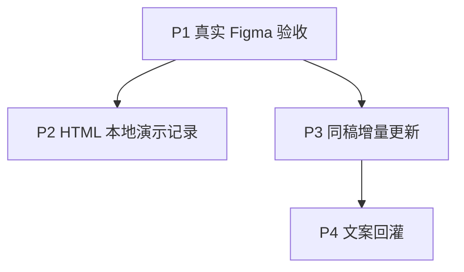

# 通用原型闭环与增量演进实施计划

> **历史快照说明（2026-10-21）：** 本文保留 2026-10-15 规划及后续注明日期的进度；“当前”“尚未实现”、授权范围和复选框均指对应历史轮次，不作为本轮执行指令或最新完成声明。当前实现边界见[架构](../../prototype/architecture.md)、[离线增量](../../prototype/incremental.md)与[原生验收记录](../../prototype/native-acceptance.md)；历史测试和原生结果不移作新提交的验证。

> **2026-10-16 范围调整：** 用户已将业务代表改为工单后台、客服后台和客服H5，要求当前全部业务模块、每应用完整双端、共享离线演示数据及17语种全量验收。以[新的交付基线](../../prototype/full-business-scope.md)为后续范围依据。本文原有三样例、单一成员CRUD及阶段结果保留为历史计划和技术回归记录，不代表新范围已完成；新业务实现与验收仍为 NOT RUN。

> 面向执行 Agent：使用 `executing-plans` 按阶段执行并复核。用户已明确要求“开始执行”，当前启动 P1。本地实现及验证已获授权；签发授权和写入 Figma 仍须核对实际目标与动作，提交、推送不在本轮授权内。

**目标：** 在保持本地、离线原型定位的前提下，完成三个样例的真实 Figma 交付验收，增加可保存的 HTML 演示记录，再支持保护人工修改的同稿更新和明确文案回灌。

**架构：** PrototypeSpec 负责语义及显式数据行为声明，浏览器运行数据独立持有；Figma 更新由桥接层处理版本、节点身份和写入保护，文案回灌通过输入适配器形成新的语义候选。沿用 Node ESM、npm、Zod、现有 Plugin API 与本地桥接，不新增服务或依赖。

**状态与日期：** 2026-10-15，Asia/Shanghai；范围已通过 Q1–Q10 收敛，用户已确认执行。当前基线为 `dev` 的 `affa69539f6933c4cff5dcde2bc5f0cc092afeea`。

## 1. 已确定的范围

- P1：先验收后台成员管理，再验收移动预约、内容展示。目标是可编辑、可读、布局与声明交互可用，并完成原生 `.fig` 导出和独立回导。
- P2：HTML 继续双击离线使用；支持本地记录新增、编辑、删除、列表联动、恢复初始数据，以及数据文件保存和加载。
- P3：只更新本工具生成的同一份设计稿，支持常见文案、字段、页面和跳转变化；人工或复杂结构冲突先停。
- P4：仅回灌明确映射的标题、文案和状态提示；不反向推断布局、样式、数据、控件结构和交互。
- Figma 界面操作优先由代理自动执行，登录等必要步骤由用户配合；代理负责桥接生成、审计、证据整理和校验。已验证网页新建和重命名，桌面输入通道仍待恢复；首版不承诺无人值守。

推荐交付顺序为 P1、P2、P3、P4。P2 与 P3 没有功能依赖；P1 若因实机通道暂时受阻，可在用户授权实施后独立推进 P2，但 P1 保持 `NOT_RUN`，不得用本地结果代替。

## 2. 全局约束与执行前置条件

- Node.js 至少 22.18，沿用两个 npm 锁文件；本轮使用 Node 22.22.2、npm 10.9.7，已按根锁文件运行 npm ci --ignore-scripts，未修改锁文件。
- 保护现有未跟踪 `AGENTS.md`。只修改本阶段明确文件；不自动 stage、commit、push，不创建额外工作分支。
- 测试可在本地新增、保留和运行；按已有用户约定，不将新增或修改的测试文件加入提交。
- 旧 PrototypeSpec 1.0、DesignSpec 1.0 和创建任务保持兼容；不关闭签名、作用域、节点归属和人工编辑检查。
- 真实 Figma 文件标识、页面/根 ID、客户端、授权及时间均由本轮实际读取，不能填旧记录。签发和写入前必须明确实际目标及动作。
- 启动预检时本地 41731 端口无监听，当前仍无 Figma/BrowserOS MCP 调用。后续已验证 Chrome 界面控制及独立草稿创建；Windows Computer Use 可读 Figma 窗口树，但截图超时、点击被系统拒绝。插件连接、认证和写入权限均为 `NOT VERIFIED`。实机生成阶段仍不具备已确认的执行条件。
- 网页端已自动创建本轮独立测试草稿，不再要求用户重复新建。开发插件按本机配置一次；桌面通道恢复后复用已导入入口。再启动本地会话，只读检查 `status`、`document` 与认证。失败则停止 Figma 写入，不安装替代工具、不修改全局 MCP 配置。
- 不需要模型 API 密钥或新增云服务。需要现有 Figma 账户与桌面端、本地开发插件，以及限时、精确作用域的桥接授权；凭据仅留在忽略目录，排除在报告与 ZIP 外。

最脆弱的前提是本轮真实宿主能够完成配对、字体加载、原生保存和回导。任一条件失败，都只能交付缺口记录，不能把 P1 标为通过。

## 3. P1：当前生成器的真实 Figma 验收

**独立成果：** 三个样例各自有真实原文件审计、视觉和播放结果、原生导出回导证据，以及现有验证器生成的交付包。此阶段不加入增量、回灌或 HTML 数据研发。

**文件职责：** 复用 `examples/prototypes/{admin,mobile,content}`、现有 `prototype/cli.mjs` 和桥接 `scripts/workflow.mjs`。记录写入忽略目录 `.local/native-acceptance/20261015/`；新增 `docs/prototype/native-acceptance.md` 记录证据范围并链接当前报告，不改写旧日期验收结果。

- [x] 本地静态预检：插件初次检查因 CRLF 与生成器字节输出不同而失败，经现有生成命令重建后 `check:bundle` 和 doctor 6/6 通过。doctor 的 `liveFigma: NOT_RUN` 不能解释为真实连接通过。
- [x] 网页端已自动建立独立文件 `protype-code-native-acceptance-20261015`；2026-10-16 桌面插件已连接、配对并核对稳定身份，用户授权 Page 1（`0:1`）生成、审计和 PNG 导出。admin 已生成并通过独立结构审计。节点名称只帮助导航，不参与身份授权。
- [ ] 核对 mobile/content 的独立 Page 与明确授权，完成其实际生成。
- [ ] 首先生成 admin，再生成 mobile/content，分别使用 `admin-demo`、`mobile-demo`、`content-demo` 项目 ID；输入为两个样例 PRD 和 content React 目录。产物分别写入上述根目录的 `admin/artifacts`、`mobile/artifacts`、`content/artifacts`。目录已存在即停止，分配下一运行序号，不能覆盖或复用旧证据。
- [ ] 每例使用新的 run ID、开始时间、证据目录与明确作用域，重新生成并固定内容对应的 spec ID/signature；相同内容重试可保留相同 spec 身份，不手改 ID 或签名。内容变化时由现有生成规则产生新 spec ID。按实际规格申请 `read/design/export`；没有全局资源时不沿用旧示例的 `metadata_write`。签发目标和动作须得到明确授权。
- [ ] 在会话中执行 `plan`，检查字体与替代结果；分批 `apply` 至 `COMPLETE`，随后完整 `audit`。只接受原文件结构 `PASS`、`writes: 0`、`errors: []`，并核对节点、反应、flow 与本轮规格。
- [ ] 逐页逐状态检查文字可读、无重要裁切、遮挡、缺失或不合理溢出。人工确认合格的原文件 PNG 作为本次回导比较的参考图，不能用待验收的回导图当自身参考。
- [ ] Present 检查三样例全部声明点击导航和主流程；桌面样例使用 1280×800 与 1024×768 窗口，移动样例使用 390×844 与 360×800 窗口，记录适配行为。空/错误状态若不能由主路径触发，单独在画布检查并记录，不能声称已验证真实异步失败。
- [ ] 在单独探针或副本验证原生文字可编辑，以及人工改文案后既有创建写入被保护检查阻止。探针不能污染用于导出交付的干净样例。
- [ ] 用户保存原生 `.fig`，记录实际操作与哈希；导入为新的独立文件，重新确认新身份与授权，进行只读回导审计、代表 PNG 比较与两种窗口的 Present 验证。
- [ ] 复用 `delivery/manifest.example.json` 的结构填写实测记录，运行现有 `scripts/verify-delivery.mjs`，验证生成的 ZIP 并解包重验。默认像素容差为零；若确有字体或渲染差异，保留失败图和实测差异，先由验收人确认具体容差及理由，再重新验收，不扩大阈值掩盖布局缺陷。

**通过门槛：** 三例分别完成以上环节，且交付验证退出码为 0。退出码 2 代表缺失或未运行，1 代表失败；不能写成通过。原文件可用性、结构、回导一致性与 Present 分别记录。

**能力边界：** 三个现有样例不含计时动作，三例通过不代表计时通过。若本阶段实际发现计时需求，使用新 run 独立核对面板单位与播放时长；不依据历史宿主版本直接修改全局 `timerUnit`。

**失败处理：** 超时或断连先记录未知结果并审计，再显式恢复，禁止直接重放。源码缺陷须先复现并形成独立修复范围；修复后重跑相关用例和受影响实机门槛。不通过清空文件或丢弃人工修改恢复进度。

## 4. P2：离线 HTML 的演示记录与数据文件

**独立成果：** 成员管理完整演示新增、编辑、删除、列表更新；双击 HTML 后可保存/加载演示数据并恢复初始值。无后端、无网络依赖，Figma 中仍是设计表示。

**文件职责：** 修改 `prototype/core/model.mjs`、`core/merge.mjs`、`inputs/prd.mjs`、`renderers/html.mjs`、`renderers/figma.mjs`、`pipeline.mjs`；新增 `prototype/core/demo-data.mjs` 保存纯数据校验/操作与兼容指纹逻辑。更新 admin 样例及 `docs/prototype/prd-format.md`、`incremental.md`。测试放在现有产品与浏览器测试目录，不提交测试文件。

`demo-data.mjs` 的浏览器可复用部分实现为不依赖 Node、Zod、模块外变量的自包含纯函数工厂，供模型校验和 HTML 运行时共用。沿用现有函数序列化方式内嵌工厂与运行时，重新计算 CSP 脚本哈希；兼容指纹在生成端使用现有 digest 计算后嵌入。不得在离线 HTML 中留下 npm import、外部模块加载、动态 eval 或未打包的 Node 调用。

### 数据与兼容契约

- 显式声明集合、字段 ID/类型/必填/枚举、初始记录、稳定记录 ID、列表列绑定、表单字段绑定、行级编辑/删除动作及导航。支持 `openCreate/openEdit/saveRecord/deleteRecord/cancelEdit` 五种演示效果；`saveRecord` 按当前明确模式创建或更新，不能凭按钮文案猜测。
- 新能力使用 PrototypeSpec 1.1；读取层保留 1.0 支持并集中归一化。无演示数据声明的旧输入和输出仍保持 1.0 与原行为；语义合并前由兼容层统一版本，不把版本差异当用户字段冲突。
- 原型定义保存 seed 与行为声明；运行记录和编辑上下文属于独立 RuntimeData。CRUD 不改 `generated.json`、需求事实或 Figma 规格。
- 数据文件格式名固定为 `prototype-demo-data`、格式版本 `1.0`，包含 `projectId`、`dataSchemaHash`、`sourceRevision`、导出时间和集合记录。兼容指纹包含集合/字段稳定 ID、类型、约束与绑定，排除文案、颜色、布局和记录值。
- 文件仅保存已提交记录，不保存密码、未提交草稿或选中行。集合禁止声明 password 类型或绑定密码控件，密码控件继续按旧路径临时显示。不同项目拒绝；同项目同数据契约允许跨纯文案版本加载；结构变化拒绝，首版没有自动迁移。
- 导入完整校验后一次性替换当前记录，失败保持当前状态；不自动合并。界面显示待导入记录数量与替换范围，由用户确认。恢复初始示例只重置当前运行数据和草稿，不删除用户下载的文件。
- 文件上限 2 MiB，最多 20 个集合、每集合最多 1000 条记录、全文件最多 2000 条记录、每记录最多 50 个声明字段、字符串最多 4000 字符。相同预算约束初始 seed、每次 CRUD 后候选快照、导入和导出，不能形成有效但无法保存的运行状态。拒绝未知字段/集合、重复 ID、非法类型/枚举/引用和危险属性键；不得将外部对象深合并进原型对象。
- 以显式保存/加载文件作为可靠路径；首版不承诺 `file:` 下自动缓存，不新增自动保存服务。旧静态列表继续可用。

### 任务与验收

- [ ] 先建立模型、数据文件与纯数据操作的失败用例，再实现版本兼容、严格校验和稳定记录身份。
- [ ] 在 PRD 中增加显式数据声明、绑定和效果语句；解析不明确时报告诊断，不从 React 文案推断业务副作用。完整 PrototypeSpec JSON 同样支持声明能力。
- [ ] 将 admin 列表绑定 `members` 集合，字段为姓名、演示邮箱、职能；两个 seed 使用明确虚构的示例地址。行级按钮携带记录 ID，新增空表单、编辑回填、有效提交更新列表、取消不变更数据、删除最后一条进入真实空列表。
- [ ] 实现保存、加载、恢复初始数据；文本继续用 `textContent`。Figma 只渲染声明的初始设计状态，不能将 HTML 运行记录偷偷打入设计规格。
- [ ] 运行成员 CRUD、无效表单、删除确认、取消、文件往返、跨项目拒绝、数据契约变化拒绝、过大/损坏 JSON、重复记录、脚本字符串及旧样例兼容用例；浏览器观察无外部请求、无横向溢出。

**通过门槛：** 成员管理一整条 CRUD 与文件往返在真实浏览器通过，错误导入不改当前数据；旧三个样例回归通过。新模型使 Figma 初始设计发生变化时，必须另留新版本原生复验记录，不能沿用 P1 的 PASS。

**回退：** 不启用演示数据声明的原型继续走旧静态路径；保留原始数据文件。结构不兼容只拒绝导入，不转换或损坏用户记录。

## 5. P3：保护人工修改的同稿增量

**独立成果：** 修改文案、新增/删除受管字段或页面、修改跳转后，可以更新同一份受管设计稿；未删除且原生类型不变的节点保留 ID。冲突未解决时没有计划内写入。

**文件职责：** 编译侧修改 `prototype/renderers/figma.mjs`、`pipeline.mjs`，新增 `prototype/renderers/figma-bindings.mjs`；桥接侧新增 `.research/local-figma-bridge-poc/design/update.mjs` 负责纯计划/校验，新增 `plugin/design-update-runtime.mjs` 负责宿主执行。修改 `design/commands.mjs`、`relay/protocol.mjs`、`relay/bridge-server.mjs`、`mcp/server.mjs`、`scripts/workflow.mjs` 及插件入口/打包脚本。更新生成区只通过生成器。此阶段超过 8 个文件，单独审查协议、权限和运行时边界，避免并发编辑同一文件。

### 更新契约

- 保留不可变 DesignSpec 版本，不让旧 `scope_design_apply` 接受可变规格。新增 `scope_design_update_plan`、`scope_design_update_apply`、`scope_design_update_audit`；CLI 对应 `update-plan/update-apply/update-audit`。
- 用持久 `instanceId` 识别同一受管实例，绑定项目、workspace/task、文件与 Page/root；`semanticKey` 识别逻辑节点；`baseRevision/targetRevision` 标记版本。不同文件、任务、根作用域不得自动认领。
- 首次登记既有生成稿前，必须以旧不可变 spec、原创建账本和新鲜回读验证来源唯一且未被冒用。登记是 `update-apply` 中明确列出的首个元数据写操作，需要精确目标的 `design/update/metadata_write` 授权；`update-plan/audit` 绝不隐式登记或写接管标记。登记后保存独立更新账本；旧创建任务标记已被更新流接管，过期旧 apply 必须拒绝，不能拿旧基线覆盖新版本。未登记的旧创建流程保持兼容。
- 产物增加 `figma-bindings.json`，记录受管节点键、语义路径、派生属性和可回灌白名单，并与模型/spec 摘要绑定。Figma 专属差异规划位于桥接 `design/`，不把 Figma API 或快照结构塞进通用 `core/`。
- 三方比较使用上次机器基线 B、本轮目标 N、当前实际 F：只有 N 改则更新；只有 F 改则保留受支持人工覆盖；双方改成相同值则收敛；同字段分叉则冲突。机器基线和有效人工覆盖分别保存。
- 首版人工覆盖白名单限 FRAME/TEXT 的位置尺寸、可见性、不透明度、无资源绑定的纯色填充/描边；FRAME 圆角；TEXT 文案、可加载的明确字体、字号、行高。非白名单改动、mixed 值、未知资源/样式绑定、自动布局或组件结构改造均报告冲突，不能清空摘要后认领。更新快照须覆盖这些可接受字段及相关不支持属性的检测，读取不完整时标 `NOT_VERIFIED` 并阻止相关更新。
- `update-audit` 比较机器目标与已确认人工覆盖合成的有效目标，单独列出相对机器目标的覆盖差异；不能继续以“必须完全等于原始机器 spec”作为唯一通过条件。接受的覆盖不得混入机器基线。
- 只读审计遇到内容漂移时仍返回完整可校验的观察快照及漂移诊断，不将漂移结果改标 PASS。身份、归属、资源或读取完整性错误仍明确失败。P4 可从“完整观察但存在白名单文字漂移”的结果提取候选；不能从读取不全或越界的审计结果回灌。
- 计划记录精确目标、基线、当前快照、受影响节点及引用、操作顺序和 `planHash`。先检查整份计划，再写入；每次写前与异步回读后重新核对版本/快照。已知冲突、过期计划和重复绑定均拒绝。
- `update-plan/audit` 仅需读权限。更新写入须有 `design/update`；包含新增、删除、导航时分别额外要求 `create/delete/prototype`。在 relay 验证所需动作集合并贯穿可信消息校验，不允许只在客户端判断。
- 删除须逐项列入计划并得到明确选择，执行时校验入向引用和后代；人工修改、未管理后代、外来引用或竞争结构变化强制冲突。引用观察范围或完整性不足时记 `NOT_VERIFIED` 并阻止删除，不把“未发现”解释成“不存在”，也不擅自扩大读取范围。需要补充观察时，先取得具体范围的只读授权，再重建计划。未管理节点不移动、不删除、不自动收编。
- 首版支持同父受管节点的明确顺序变化；跨父移动、节点换类型、ID 重命名、复杂组件/实例重构、共享资源批量修改及语义模板与 capture 子树切换均报告不支持。旧字符串列表的按下标项不承诺稳定身份；P2 有稳定记录 ID 的 seed 项才可参与可靠记录级更新。

### 任务与验收

- [ ] 先完成稳定绑定、纯更新计划和三方冲突用例，再接入协议与原生执行；不得先取消旧人工编辑 guard。
- [ ] 为新增、更新、重排、删除和反应变化建立确定操作序列、幂等标记、pending 回执和检查点。只有完整回读通过，才推进机器基线。
- [ ] 测试无变化重跑零差异、单字段更新、人工异字段保留、同字段冲突、长文案引起几何变化、新增/删除字段与页面、入向跳转、人工子节点、过期计划、越界授权、跨批次并行编辑与断连恢复。
- [ ] 在 admin 生成稿执行上述代表变更，逐项核对 node ID、实际属性、未受影响页面、人工布局、反应和完整审计；在 mobile/content 复验代表更新，并完成当前版本视觉/Present 与交付回归。

**通过门槛：** 已知冲突在写入前阻止；不受影响节点及受支持人工覆盖保持；重复操作不重复创建；过期计划和权限不足没有副作用；中断状态可审计、可显式恢复。

**失败与回退：** Figma 批次没有全局事务，本阶段不承诺全有或全无。未知结果保留 pending、停止后续写入，先审计再显式恢复。每次结构更新前保存本轮备份；必要时由用户将 `.fig` 恢复到独立文件。恢复后的文件需要新身份核验，不能自动认领为原实例，也不执行未经确认的反向删除。

## 6. P4：明确文案的有限回灌

**独立成果：** 从已登记实例读回页面标题、控件文案和状态提示，形成可审阅候选；确认后生成新的 PrototypeSpec、HTML 与 ZIP。

**文件职责：** 新增 `prototype/inputs/figma-edits.mjs`；修改 `prototype/cli.mjs`、`pipeline.mjs` 和绑定生成器；复用现有 `core/merge.mjs`。桥接复用 P3 的受控回读与基线，不开放任意 JS 执行。

- [ ] 新增本地输入 `--figma-edits`，与 `--input/--project` 三选一；另要求 `--bindings`、`--base`、`--edited`、`--generated-baseline` 与新输出目录。`--figma-edits` 读取 P3 `update-audit` 保存的完整实际回读，`--bindings` 读取同基线编译产物。检查完整项目/实例身份、基线、spec 与绑定摘要，未知或过期材料拒绝。
- [ ] 具体 CLI 验证命令为 `npm run prototype -- --figma-edits .local/figma-edits/20261015/admin-update-audit.json --bindings .local/figma-edits/20261015/admin-bindings.json --base .local/figma-edits/20261015/admin-applied-prototype.json --edited .local/figma-edits/20261015/admin-local-edited.json --generated-baseline .local/figma-edits/20261015/admin-generated.json --out .local/figma-edits/20261015/admin-candidate`。审计和绑定由本轮 P3 实际导出；`admin-applied-prototype.json` 是该绑定对应的已应用有效模型，`admin-generated.json` 是其原始机器基线，`admin-local-edited.json` 是用户当前有效模型。没有这些真实输入时拒绝，不生成替代数据。
- [ ] 仅接受绑定明确的 `page.title`、普通文本/按钮/列表标题的 `element.label`、`state.message`。必填星号、自动占位符、拼接状态标签等派生文字不直接回灌；`state.label` 虽有模型字段，但首版不从复合渲染文案中反向拆解。
- [ ] 采集来源文字、列表记录、HTML 演示数据、坐标尺寸、字号颜色、层级、控件增删和反应/flow 均排除。多个状态副本对同一字段出现不同修改时产生冲突，要求明确选定同一个语义值。
- [ ] 三方角色固定为：B 是 `--base` 的已应用有效模型；N 是在 B 上应用白名单 Figma 改动得到的候选；L 是 `--edited` 的当前本地有效模型。G 是 `--generated-baseline` 的原始机器基线，必须与绑定记录的来源哈希一致。先合并 B/N/L，不能用 G 代替节点绑定的实际模型，也不把回灌候选当机器新生成值。
- [ ] 首次运行只输出 `candidate.json`、`edits-diff.json`、`conflicts.json`，不生成可交付 HTML，不改变旧产物、PRD 或 Figma。新增 `--accept-edits` 读取严格确认文件，格式版本 `1.0`、`candidateHash` 与 `acceptedPaths` 必须精确匹配本轮差异；有冲突时同时要求原有 `--resolutions` 路径到 `edited/generated` 的选择文件。两个文件职责分开，旧 resolutions 格式保持不变；在本模式中 `generated` 指 N 分支，`edited` 指 L 分支。确认后使用同一输入、确认文件和另一个新输出目录生成 HTML/ZIP，并运行模型/引用与需求追踪校验。候选或路径变化则旧确认失效。
- [ ] 输出 `generated.json` 必须保持 G，不得落入 `buildArtifacts` 将有效模型默认当 generated 的路径；输出 `prototype.json` 为合并确认结果。基线字节/摘要不变、已有本地人工修改不丢失须加入验证。回灌成功不自动推进 Figma 的机器基线，也不自动触发写入。下一次正向更新仍走 P3。
- [ ] 验证一处绑定修改成功、各状态一致修改成功、跨状态分叉冲突、同字段需求竞争、过期绑定/错误文件拒绝、派生/capture 文案拒绝、旧输出保持，以及新 HTML 实际显示确认后的文案。

**通过门槛：** 白名单文案完成真实 Figma → 候选确认 → 新 HTML 的往返；越界属性无静默丢弃或误映射。布局和样式可继续保留在 Figma，但不声称已同步到 HTML。

## 7. 验证、交付与工程量

每个阶段先运行相关定向 `node --test` 用例，失败用例应证明所需行为尚不存在；实现后再运行完整适用检查。公共模型、协议和插件变化执行根目录 `npm run check:bundle`、`npm test`、`npm run acceptance`、`npm run test:browser`，并按 CI 运行两个包的 `npm audit --audit-level=high`。插件源变化先运行桥接 `npm run build:plugin`。当前没有 lint/typecheck 脚本，不编造对应结果。

源码/模型测试、替身、真实浏览器、真实 Figma、视觉、Present 和原生交付分别记 `PASS/FAIL/NOT_RUN`。`npm run acceptance` 的 `figmaNative: NOT_RUN` 不直接改成 PASS；本轮原生结果使用独立证据记录，以源版本和 spec 摘要关联。

每阶段交付实现摘要、精确文件清单、验证结果、限制和 ZIP。ZIP 仅包含报告及明确引用的可复验材料，排除 session、grant、凭据、缓存和无关个人资料；回读清单及哈希后再交付。代码整合另需明确授权，遵守中文 Conventional Commits/PR 规范，不把验证结果写进提交消息，不提交测试文件。

粗略工程预算，作为排期估算而非实测工时或交付承诺：P1 约 1–2 个工程日加实机配合与修复时间；P2 约 3–5 日；P3 约 6–10 日；P4 约 2–4 日。P3 是风险最高项。出现宿主缺陷、字体差异或中断恢复缺陷时，先报告实际范围再修订预算。

## 8. 方案依据与确认点

- 本仓库已有稳定语义 ID、模型三方合并、节点快照、归属检查和交付验证器，可直接复用。当前 spec 内容变化会生成新 ID，namespace 又含 spec ID，因此原生增量需要独立实例身份，不能仅更换命令名称。
- [Figma PluginData 官方文档](https://developers.figma.com/docs/plugins/api/properties/nodes-setplugindata/)支持保存节点映射，但其作用是插件数据存储，不是安全凭据仓库；插件 ID 变化还会影响读取。
- [Penpot 更新实现](https://github.com/penpot/penpot/blob/develop/backend/src/app/rpc/commands/files_update.clj)提供变更批次、修订与记录机制；其修订判断并非本计划所需的严格写前一致性条件，因此本计划额外要求快照前置校验。
- [Excalidraw 合并实现](https://github.com/excalidraw/excalidraw/blob/master/packages/excalidraw/data/reconcile.ts)以稳定 ID 和版本确定性合并。这里借鉴稳定身份和元数据贯穿；不采用自动选胜者覆盖同字段人工修改。
- [MDN localStorage 文档](https://developer.mozilla.org/en-US/docs/Web/API/Window/localStorage)指出 `file:` 下行为未定义，因此数据文件是首版可靠保存路径。

最小方案是只补 P1 并继续交付离线静态原型；用户已明确选择增加本地记录及往返能力，因此采用四个独立阶段。完整双向设计同步、任意现有稿识别、真实后端、跨结构数据迁移和无人值守均不进入本计划。

本计划已覆盖 Q1–Q10 的选择，其余保存、兼容、删除预览和冲突规则为明确推荐默认。请用户确认这些规则是否符合共同理解；确认计划不自动授权 Figma 目标写入。收到明确实施请求后，才进行连接预检、目标确认与逐阶段实施。

## 执行进度（2026-10-15）

P1 的本地检查、Windows HTML CSP 修复和实机取证见 [真实 Figma 验收与自动化入口](../../prototype/native-acceptance.md)。2026-10-16 已通过仓库桌面插件实际生成 admin，独立结构审计 PASS，五张 PNG 已导出并逐张检查。Windows 点击及截图通道仍未可靠恢复，Present、原生 `.fig` 导出回导及 mobile/content 实机验收仍为 NOT RUN，P1 未完成。P2–P4 尚未实现。
